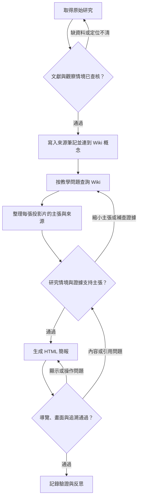

# 從外形能看出微膠細胞在做什麼嗎？

[LLM Wiki](../pages/microglia-wiki.html) · [HTML 教學簡報](../pages/microglia-morphology-slides.html) · [網站首頁](../index.html)

Wiki 把五篇小鼠原始研究整理成可查詢的繁體中文知識庫。讀者可從形態、突起動態、發育情境與吞噬證據四個概念進入，再沿引用找到來源筆記及原文。簡報把相同的證據轉成入門案例與判讀練習。

## 先討論、後生成

討論階段比較了「形態與功能判讀」和「聚焦吞噬判讀」兩個方向。選定前者後，保留既有指南的兩個形態主題，以吞噬作為證據判讀案例。生成階段先寫 Wiki 並保留研究情境，再從 Wiki 取出投影片所需的主張。本次在 Codex 對話中由 LLM 依序執行，網站使用靜態 HTML 和共用 CSS。

## 課堂示範對照（2026-11-21）

依影片官方章節說明，把指定的六個時間點整理成四段。這份整理以章節資訊為基礎。

| 階段 | 老師的示範 | 本題的實作 |
| --- | --- | --- |
| 一 | [36:50](https://www.youtube.com/watch?v=pEmuTl9vTf8&t=2210s) 在 Antigravity 設定專案，先談 Wiki 需求。 | 在 Codex 延續既有網站，先確認題目、讀者與證據範圍，再補寫 [Wiki 維護規則](../wiki/rules.md)。 |
| 二 | [1:00:04](https://www.youtube.com/watch?v=pEmuTl9vTf8&t=3604s) 確認規則、匯入文獻，從 Obsidian 檢查知識庫。 | 將已查核的 5 篇研究整理為獨立來源筆記，建立 4 篇概念條目和 [Markdown 索引](../wiki/index.md)。以連結驗證檢查 Markdown 結構。 |
| 三 | [1:17:03](https://www.youtube.com/watch?v=pEmuTl9vTf8&t=4623s) 比較單次 Prompt 與 Loop；[1:25:20](https://www.youtube.com/watch?v=pEmuTl9vTf8&t=5120s) 確認簡報需求與呈現。 | 先留單次大綱，再逐張回讀 Wiki，確定七張簡報的讀者、版式、比較卡與練習。詳見[大綱審查](microglia-slide-outline.md)。 |
| 四 | [1:31:38](https://www.youtube.com/watch?v=pEmuTl9vTf8&t=5498s) 審大綱、製作投影片並留檢查紀錄；[1:45:07](https://www.youtube.com/watch?v=pEmuTl9vTf8&t=6307s) 用 Git 與 GitHub 整理繳交成果。 | 先審大綱，再檢查與修訂 HTML。以 Git 差異及下方的重跑紀錄留存可交付結果。 |

## Loop / graph

- **每篇研究重複查核。** 確認作者、年份、DOI 和原文證據位置。原入口讀不到時找同篇原文的可讀版本；原文能支持的條件與限制一起寫入 Wiki。
- **每張有學術主張的投影片重複比對。** 用 Wiki 回答該張的教學問題，把物種、腦區、時間或影像條件與主張一起檢查。需要修正時先改主張或回查文獻，通過才生成該張內容。
- **每次改動後複查受影響的畫面和連結。** 版面或導覽問題回到 HTML；引用或主張問題回到證據檢查。這樣可以在套版前處理科學內容，減少已完成投影片的重工。

## 投影片與 Wiki 對應

| 投影片 | 查詢問題 | Wiki 條目與文獻 |
| --- | --- | --- |
| [1 開場](../pages/microglia-morphology-slides.html#slide-1) | 這堂課要練習什麼？ | [形態描述](../pages/microglia-wiki.html#shape)，學習目標 |
| [2 形態](../pages/microglia-morphology-slides.html#slide-2) | 如何描述胞體與突起？ | [形態描述](../pages/microglia-wiki.html#shape)，[2](../pages/microglia-wiki.html#ref-2)、[3](../pages/microglia-wiki.html#ref-3) |
| [3 動態](../pages/microglia-morphology-slides.html#slide-3) | 時間序列增加了什麼證據？ | [突起動態](../pages/microglia-wiki.html#dynamics)，[1](../pages/microglia-wiki.html#ref-1)、[2](../pages/microglia-wiki.html#ref-2) |
| [4 發育](../pages/microglia-morphology-slides.html#slide-4) | 哪個發育情境可見阿米巴型？ | [發育情境](../pages/microglia-wiki.html#context)，[3](../pages/microglia-wiki.html#ref-3) |
| [5 吞噬](../pages/microglia-morphology-slides.html#slide-5) | 什麼證據支持材料已吞入？ | [吞噬證據](../pages/microglia-wiki.html#engulfment)，[4](../pages/microglia-wiki.html#ref-4)、[5](../pages/microglia-wiki.html#ref-5) |
| [6 練習](../pages/microglia-morphology-slides.html#slide-6) | 圓鈍外形與二維重疊支持什麼？ | [發育情境](../pages/microglia-wiki.html#context)、[吞噬證據](../pages/microglia-wiki.html#engulfment)，[3](../pages/microglia-wiki.html#ref-3) 至 [5](../pages/microglia-wiki.html#ref-5) |
| [7 複習](../pages/microglia-morphology-slides.html#slide-7) | 下次看圖要確認哪些資訊？ | [形態](../pages/microglia-wiki.html#shape)、[動態](../pages/microglia-wiki.html#dynamics)、[吞噬](../pages/microglia-wiki.html#engulfment) |

## 實際執行紀錄（2026-11-18）

| 節點 | 實際檢查與處理 |
| --- | --- |
| 取得原文 | Davalos 的 DOI 導向出版商授權頁，工具無法讀取；改讀明尼蘇達大學託管的同篇 PDF。Schafer 的 PMC 入口遇到瀏覽器驗證，改用同一文章的數字路徑定位原文。 |
| 納入 Wiki | 五篇均找到對應的原始研究文字或圖說，保存 DOI、查核版本、圖號、觀察條件、主要發現與限制。 |
| 比對主張 | 針對容易誤讀的「損傷後整個細胞移動」「圓形可判定發炎」「二維重疊可判定吞噬」做反例核對。Davalos 的時間序列區分突起與胞體，Hagemeyer Fig. 1 提供發育期反例，Schafer Fig. 1 給出逐層確認與胞內區室證據。三種判讀皆在寫入投影片前排除。 |
| 產生簡報 | 一份 HTML 共 7 張。第 2–5 張提供 Wiki 條目及來源筆記的直接連結。第 6 張用假想情境練習。 |
| 瀏覽驗證 | 首次連結檢查發現「Wiki 文獻」的目標缺少錨點，補上後重跑。使用 Playwright 驅動本機 Edge，在 1440 × 1000 與 390 × 844 驗證 5 個 HTML 頁面的共用 CSS、畫面寬度與跳至主要內容的焦點。兩種尺寸各核對 113 個 HTML 站內連結，並操作首頁 → 簡報 → 逐張翻頁 → 鍵盤展開解答 → Wiki 條目 → 回首頁，以及首頁直接進入 Wiki。流程文件內的相對連結與錨點也一併核對。 |

## 反思

這次實際遇到最多操作問題的是**取得原文**，有兩個入口受限。在教學內容上，最容易出錯的是**從證據寫成主張**，尤其容易省略觀察的時間、解剖位置或影像深度。上面的三個例子是針對誤讀設計的核對，並非三次發布後的錯誤。

因此把原文是否可讀、能否指出證據位置的檢查提前到**納入 Wiki 前**。也在**整理投影片主張時**先把研究條件和來源放在同一筆內容，再比對證據。流程圖因此加入前端查核與回查分支，瀏覽階段保留一次引用與呈現檢查。這樣能在 HTML 生成之前定位是來源缺口，還是教學文字超出證據。

## 依課堂流程重跑（2026-11-21）

- 單次大綱在第 3–5 張欠缺研究情境或證據細節，回到來源筆記逐張補齊。第 5 張加入出生後第 5 天與視網膜輸入，將成像證據連回具體研究對象。
- 本輪以相對連結檢查代替在 Obsidian 中操作。檢查 13 份 Markdown、71 個站內連結及 5 個相異 DOI，均通過。
- Playwright 驅動 Edge，於 1440px 與 390px 重跑首頁 → 七張簡報 → 鍵盤展開解答 → Wiki → 回首頁，均通過。
- 本輪的主要問題出現在單次大綱的證據精度，因此把來源位置與研究條件提前到大綱審查。證據不足先回查 Wiki，HTML 階段才處理翻頁、版面與連結。
