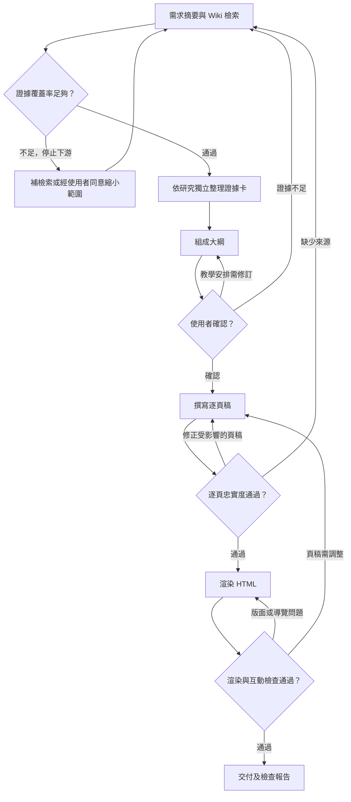

# Wiki 到教學簡報的 Graph

依課堂示範拆出覆蓋率、人工確認、忠實度與渲染關卡。 [課堂 Graph](https://www.youtube.com/watch?v=pEmuTl9vTf8&t=6450s)

| 節點 | 輸入 → 輸出 | 負責與通過標準 |
| --- | --- | --- |
| 檢索及覆蓋率 | 需求、Wiki → 問題與文獻對照 | Codex 逐題檢查。每題都有符合條件的直接觀察或可明確說明的限制。 |
| 證據卡及大綱 | 來源筆記 → 證據卡與七張大綱 | Codex 按研究逐筆整理，再組合教學順序。每張案例可追溯。 |
| 大綱確認 | 大綱 → 使用者確認或修訂意見 | 使用者確認教學內容、順序與範圍。此關卡通過後才可寫稿。 |
| 逐頁稿及忠實度 | 確認的大綱、證據卡 → 逐頁稿、逐頁查核結果 | Codex 核對主張、研究條件、圖號及推論限制。預先標明假想情境。 |
| HTML 與渲染 | 通過忠實度的頁稿 → HTML、瀏覽結果 | Edge 在 1440px 和 390px 檢查橫向溢出、翻頁、焦點、練習與 Wiki 連結。 |
| 交付 | HTML、Wiki、兩類檢查結果 → 成果與實際執行報告 | 記錄各關結果、問題與重測，保留使用者確認紀錄。 |

[需求摘要](microglia-requirements.md) · [證據卡與待確認大綱](microglia-graph-outline.md) · [實際檢查報告](microglia-graph-check-report.md)
